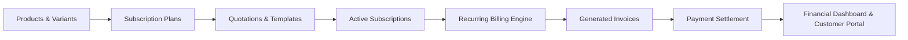

<<<<<<< HEAD
# Brightloop Subscription Management System

[](https://nextjs.org/)
[](https://react.dev/)
[](https://www.typescriptlang.org/)
[](https://tailwindcss.com/)
[](https://supabase.com/)
[](file:///tests/)

Brightloop is an enterprise-grade subscription management and recurring billing platform built for the **Odoo × Lucknow Hackathon**. It automates the end-to-end customer subscription lifecycle from product catalogues and quotation offers to recurring billing runs, invoice reconciliation, partial payment settlements, and customer self-service.

---

## Complete Business Workflow



---

## Key Features & Highlights

### 1. Product Catalogue & Plan Engine (Phases 1–2)
- **Odoo Variant Pricing (T-07)**: Dynamic attribute pricing with positive/negative price deltas (e.g. Odoo Enterprise Tier `+$560.00`).
- **Flexible Billing Intervals**: Daily, weekly, monthly, and annual billing intervals with calendar-safe month-end anchor preservation (e.g. Jan 31 → Feb 28/29 → Mar 31).
- **Policy Flags**: Per-plan governance for `allowEarlyClose`, `allowPause`, `allowRenewal`, and `autoCloseOnEnd`.
- **Taxes & Coupons (T-17 to T-21)**: Percentage-based sales and service taxes; flat and percentage discount coupons with product vs. subscription scope, minimum quantity, and expiry bounds.

### 2. Quotation & Subscription Lifecycle (Phase 3)
- **Quotation Templates**: Reusable quotation packs pre-bundled with products, variants, and payment terms.
- **Strict Status Journey**: Enforces `draft → quotation → confirmed → active → paused → closed`.
- **Offer Validity Enforcement (T-10)**: Prevents confirmation of expired quotation offers.
- **Contract Renewal**: Creates new linked subscriptions (`renewed_from_subscription_id`) without rewriting historical records.

### 3. Recurring Billing & Idempotent Invoicing (Phase 4)
- **Idempotent Recurring Billing (T-13 to T-16)**: Database-level partial unique index `uq_invoices_subscription_period` on `(subscription_id, billing_period_start, billing_period_end)` guarantees zero duplicate invoices on retried or concurrent runs.
- **Price & Tax Snapshots**: Historical invoices freeze agreed prices, quantities, and tax lines at generation time, remaining unaffected by subsequent catalogue price edits.
- **Atomic Manual Payment Settlement**: PostgreSQL RPC `record_payment` with row-level locks (`FOR UPDATE`), preventing race conditions, overpayments, and balance corruption. Supports multiple partial payments.
- **Financial Dashboard**: Operations console KPI metrics for Total Invoiced, Cash Collected, Outstanding Balance, and Overdue Invoices with zero fabricated figures.

### 4. Customer Self-Service Portal (Phase 5)
- **Multi-Tenant Row-Level Security (RLS)**: Customer queries are strictly bounded to their own account; cross-customer record inspection is rejected at the database level.
- **Customer Dashboard**: Overview of active subscriptions, pending offers, recent invoices, and payments.
- **Quotation Review & Acceptance**: Customers can review itemized quotations and self-serve accept valid proposals.
- **Self-Service Subscription Governance**: Customers can pause, resume, and close subscriptions according to their plan's policy flags.
- **Payment History Ledger**: Immutable transaction receipts itemizing references, payment methods, and settled amounts.

---

## Technology Stack

- **Framework**: Next.js 16.4.3 (App Router with Turbopack)
- **Language**: TypeScript 5 (Strict Mode, `noImplicitAny: true`)
- **Styling**: Tailwind CSS v4 with CSS variables and dark mode support
- **UI Architecture**: shadcn/ui primitives + Lucide React icons
- **State & Forms**: React Hook Form with Zod runtime validation
- **Database & Auth**: Supabase PostgreSQL with `@supabase/ssr` cookies and Row-Level Security (RLS)
- **Precision Financials**: Pure decimal-safe integer minor-unit math (zero floating-point leakage)

---

## Local Development Setup

### Prerequisites
- Node.js 18+ (tested on Node 20 & 22)
- npm 9+
- A free Supabase project at [supabase.com](https://supabase.com) (or run offline in scaffolding mode)

### 1. Clone & Install
```bash
git clone https://github.com/your-username/brightloop.git
cd brightloop
npm install
```

### 2. Environment Variables
Copy the template file to `.env.local`:
```bash
cp .env.example .env.local
```

Configure your `.env.local` variables:
```env
NEXT_PUBLIC_APP_URL=http://localhost:3000
NEXT_PUBLIC_SUPABASE_URL=https://your-project.supabase.co
NEXT_PUBLIC_SUPABASE_PUBLISHABLE_KEY=your-supabase-anon-key
SUPABASE_SERVICE_ROLE_KEY=your-supabase-service-role-key
```

### 3. Database Migrations
Apply the migrations in numerical order in your Supabase SQL Editor:
1. `supabase/migrations/20261031000001_auth_and_profiles.sql` (Auth & Profiles)
2. `supabase/migrations/20261031000002_catalog_plans_taxes_discounts.sql` (Products, Plans, Taxes, Discounts)
3. `supabase/migrations/20261031000003_quotations_and_subscriptions.sql` (Quotations & Subscriptions Lifecycle)
4. `supabase/migrations/20261031000004_customer_sync_and_template_fix.sql` (Customer Provisioning & Templates)
5. `supabase/migrations/20261031000005_invoices_payments_billing.sql` (Invoicing, Payments, Billing Runs, RLS)

### 4. Seed Demo Data (Optional but Recommended)
Run `supabase/seed.sql` in the Supabase SQL Editor to populate:
- Standard products and Odoo variants
- 3 subscription plans (Monthly, Annual, Weekly)
- Active and expired discount coupons
- Enterprise quotation template
- Sample multi-tenant customer accounts

### 5. Promote First Administrator
Register your initial account at `/register`, then run:
```sql
UPDATE public.profiles
SET role = 'admin'
WHERE email = 'your-email@example.com';
```

### 6. Start Development Server
```bash
npm run dev
```
Open [http://localhost:3000](http://localhost:3000) in your browser.

---

## Verification & Available Scripts

Run the comprehensive automated test suite and build checks:

```bash
# Run all 76 unit and integration test suites
npm test

# Type check TypeScript codebase in strict mode
npx tsc --noEmit

# Run ESLint validation
npm run lint

# Build production application bundle
npm run build
```

---
## Security Invariants

- **Zero Floating-Point Arithmetic**: PostgreSQL `NUMERIC` and integer minor-unit calculations prevent rounding leakage.
- **Server-Only Security Boundaries**: Service role keys and secrets are never exported with `NEXT_PUBLIC_` or accessible in client bundles.
- **Row-Level Security (RLS)**: Enforced via PostgreSQL policies on all business tables.
- **Tamper-Proof Invoices**: Historical line items, taxes, and prices are permanently snapshotted at time of creation.

