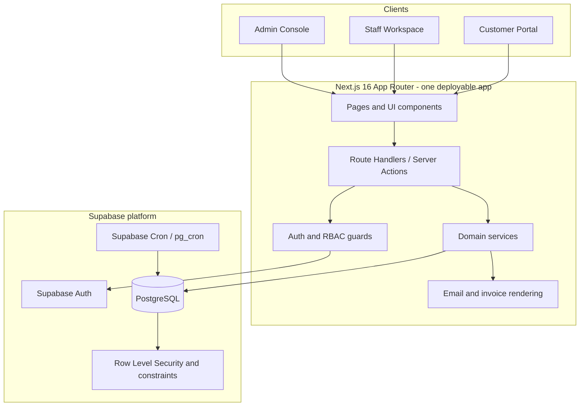

# 02 — System Architecture

## 1. Architecture decision

**Choose a modular monolith, not microservices.** A few-hour hackathon does not provide time to deploy, observe and debug several services. Keep one Next.js application and one PostgreSQL database, but enforce module boundaries in code.

### Logical architecture

## 2. Runtime responsibilities

| Component | Responsibility |
|---|---|
| Next.js App Router | Admin/staff/customer screens; server-rendered pages where practical; forms and tables. |
| Route Handlers / server-only modules | Validate input, authorize caller, call domain logic, return consistent responses. |
| Supabase Auth | Registration, login, session refresh, password reset and staff invitation. |
| PostgreSQL | System of record for catalog, customers, subscriptions, invoice, tax, discount, payments and audit events. |
| RLS + SQL constraints | Tenant/customer row isolation and invariant enforcement as defence in depth. |
| Supabase Cron (`pg_cron`) | Daily trigger for due subscription billing and automatic expiry processing. |
| Resend | Send invoice email (optional provider integration, but the UI action must work when configured). |
| Browser print / PDF rendering | Print or save invoice as PDF. |

## 3. Domain modules

Keep modules separate under `src/modules/`:

- `auth`: sign-up, login, reset password, staff invitation, profile and role checks.
- `customers`: customer records, contact/address details and customer-user mapping.
- `catalog`: products, variants, taxes and plans.
- `quotations`: quotation templates, generated quotations and validity.
- `subscriptions`: create, quote, confirm, activate, pause, resume, close and renew.
- `discounts`: rule management, eligibility calculation and redemption limits.
- `billing`: billing-period calculation, due-subscription selection, invoice generation, retry safety and job logging.
- `invoices`: invoice lifecycle, line/tax snapshots, email and print view.
- `payments`: payment recording, outstanding balance and settlement.
- `reports`: dashboard aggregates, filters and pagination.
- `audit`: critical financial/admin action history.

Each module should contain `schemas.ts` (Zod validation), `service.ts` (business rules), `queries.ts` (read queries) and route files as needed. Do not put billing arithmetic inside React components.

## 4. Key end-to-end sequences

### 4.1 Customer registration

1. Validate email and password at UI and server boundary.
2. Supabase Auth creates a unique account; password policy is minimum 9 chars + uppercase + lowercase + special character.
3. An auth trigger creates `profiles` with default role `customer` (never trust role from client-supplied metadata).
4. Registration flow creates a `customers` row and `customer_users` link.
5. Customer portal queries use authenticated session and RLS scope to that customer.

### 4.2 Admin creates staff

1. Authenticated user reaches staff-management route.
2. Server verifies active profile role is `admin`.
3. Server-only Supabase admin client invites user by email.
4. New profile role is set to `staff` by a trusted server-side operation; never accept a role from the public registration payload.
5. Audit the invitation.

### 4.3 Product, plan and quotation

1. Admin configures product, variant delta, taxes and plan.
2. Admin defines plan cadence and flags: `auto_close_on_end`, `allow_early_close`, `allow_pause`, `allow_renewal`.
3. Staff selects a quotation template; template lines are copied to a new subscription as snapshots.
4. Price snapshot = product sales price + variant delta (or authorized override); store plan price separately.
5. Staff sends quotation; expiry = creation date + template validity days.
6. Customer accepts; subscription transitions to `confirmed`, then `active` when start date is reached.

### 4.4 Recurring billing (most critical path)

1. Daily scheduled job finds active subscriptions with `next_billing_date <= today`.
2. Lock each subscription row while generating its due period(s); never process the same subscription concurrently.
3. Close expired plans/subscriptions when auto-close policy applies; skip paused/closed subscriptions.
4. Build invoice lines from plan price snapshot and subscription line snapshots.
5. Calculate eligible discount and lock/reserve its usage in the same transaction.
6. Copy current configured tax labels/rates into invoice line tax snapshots and calculate totals.
7. Insert invoice with billing period start/end and unique idempotency key.
8. Advance `next_billing_date` only after invoice insertion succeeds, inside the same transaction.
9. Record job counts/errors in `billing_runs`; a failed subscription must not stop unrelated subscriptions.

**Important reliability rule:** database uniqueness is the final guard against duplicate invoices. A job may be delivered twice, retried, or overlap with a manual “Run billing now” action. The second attempt must safely detect the already-created invoice and must not advance the schedule twice.

Use a unique index on `(subscription_id, billing_period_start, billing_period_end)` for non-null subscription invoices. Process one subscription per transaction (or a small bounded batch), use `SELECT ... FOR UPDATE SKIP LOCKED`, and catch unique-conflict retries. Never implement this as “query due rows, then insert invoices” without locking/uniqueness.

### 4.5 Payment recording

1. Staff selects a confirmed invoice.
2. Server calls one atomic database function/transaction that locks invoice, checks remaining balance and inserts payment.
3. Update `amount_paid`; set invoice `paid` only when balance reaches zero, otherwise remain `confirmed`.
4. Dashboard and customer portal read the updated values.

### 4.6 Dashboard

Use database-side aggregate queries or views; do not download all rows to the browser to calculate totals. Define labels precisely:
- Active subscriptions: count where status is `active`.
- Revenue collected: sum of completed/recorded payments in selected date range.
- Outstanding: sum `balance_due` for confirmed invoices.
- Overdue: confirmed invoices with positive balance and due date before today.
- Invoiced value: sum invoice totals in the selected date range (separate from money collected).

## 5. Database integrity and transaction boundaries

The database is the source of truth. Required invariants:

- Unique auth email (Supabase Auth) and unique customer contact email where the product policy requires it.
- Unique product code, plan code, subscription number and invoice number.
- Foreign keys on all relationships; use `ON DELETE RESTRICT` for financial/history entities. Deactivate catalogue records rather than deleting referenced rows.
- Positive quantity, non-negative prices/taxes and valid date windows enforced by CHECK constraints.
- Unique invoice per subscription billing period.
- Discount redemption uniqueness per discount/invoice and usage cap checked under a lock.
- Payment cannot exceed remaining invoice balance; `amount_paid` cannot exceed invoice total.
- Financial records are immutable after issue except permitted status/payment updates; use snapshots on invoice lines.

Keep multi-row writes atomic. Use PostgreSQL RPC functions for payment recording and recurring invoice generation where a single transaction is required.

## 6. Security model

- Supabase Auth authenticates users; `profiles.role` is the authorization source.
- Do not trust `user_metadata` or a client-submitted `role` field.
- Verify the user on the server for every protected route; check `is_active` and role.
- Enforce customer scope in RLS and in server query filters. Customer data isolation must not rely on hiding links in the UI.
- Enable RLS on every exposed business table and define policies for staff/admin and customer-owned rows.
- Admin/service-role key is server-only. Never put it in a `NEXT_PUBLIC_` variable or browser bundle.
- Staff invitation, discount creation and master-data changes require admin authorization.
- Validate every input with Zod on the server; frontend validation is only for UX.
- Store password hashes only through Supabase Auth; do not store raw passwords.
- Audit critical actions: staff invitation, pricing/plan/tax/discount changes, subscription transitions, invoice cancellation, payment record and billing run.

## 7. Performance strategy for <2 seconds

- Server-side pagination for customers, subscriptions and invoices (default 25–50 rows).
- Search/filter at database level, not browser-side across all records.
- Add indexes for status/date/customer/foreign-key filters and RLS predicate columns.
- Composite index examples: `(status, next_billing_date)`, `(customer_id, created_at DESC)`, `(status, due_date)`, `(subscription_id, billing_period_start, billing_period_end)`.
- Avoid N+1 lookups; join or fetch relation collections in bounded queries.
- Dashboard uses aggregate SQL and date filters.
- Use `EXPLAIN ANALYZE` against seeded 5,000+ records; target p95 below 2 sec for core list/dashboard requests. The PDF says every page under two seconds; test all important pages rather than claiming it without measurement.

## 8. What not to build in this hackathon

Do not add microservices, Kafka, Kubernetes, a separate Celery/Redis cluster, card/UPI charge collection, elaborate revenue recognition, multi-entity accounting, tax jurisdiction engines, usage metering, trials or AI recommendation features unless core requirements are already complete. The official Odoo hackathon page says all languages are welcome and emphasizes dynamic data, validation, clean responsive UI, intuitive UX and Git collaboration; it does not state that the project must be implemented as an Odoo module. It also lists local/offline readiness as a nice-to-have, so keep a local Supabase option available if Docker is installed. These are not needed to satisfy the supplied brief.

## 9. Researched industry patterns and implications

| System/source | Documented pattern | Decision applied here |
|---|---|---|
| Odoo Subscriptions | Recurring plans define billing periods; Odoo also documents automatic closing in the context of unpaid invoices, quotation expiration/payment terms, scheduled invoice generation and customer self-service close actions. | Use explicit plan-level flags and scheduled billing. Keep this brief's `expiry_date` auto-close rule distinct from Odoo's unpaid-invoice closing behavior. |
| Stripe Billing | Subscription items expose explicit current-period start/end; item periods can differ and subscription changes may arrive asynchronously. | Persist each billing period and process lifecycle changes deterministically. This MVP uses one plan cadence per subscription; mixed-cadence items are a future extension. |
| Chargebee support | Dunning can retry failed online payments and notify customers. | Dunning is a future extension only; manual payment recording is sufficient for the PDF. |
| PostgreSQL | Unique constraints create unique indexes and enforce invariants at the database layer. | Unique subscription-period invoice key is mandatory for retry safety. |
| Supabase | Provides full Postgres, Auth and RLS; Cron can run SQL or invoke a function. | Use Supabase as the integrated backend foundation and schedule billing in the database. |

### Official references

- Odoo 18 — Create a subscription quotation and recurring plans: https://www.odoo.com/documentation/18.0/applications/sales/subscriptions/sales_flow/create_a_quotation.html
- Odoo 17 — Scheduled actions for recurring invoices: https://www.odoo.com/documentation/17.0/applications/sales/subscriptions/scheduled_actions.html
- Odoo 19 — Closing subscriptions and self-service options: https://www.odoo.com/documentation/19.0/applications/sales/subscriptions/closing.html
- Stripe — Determine subscription billing cycles: https://support.stripe.com/questions/how-to-determine-when-a-subscription-cycles-using-webhooks?locale=en-GB
- Stripe — Subscription webhook event concepts: https://docs.stripe.com/billing/subscriptions/webhooks
- Chargebee — Dunning overview: https://support.chargebee.com/support/solutions/articles/237885-what-is-dunning-in-chargebee-
- PostgreSQL — Constraints: https://www.postgresql.org/docs/current/ddl-constraints.html
- Supabase — Database overview: https://supabase.com/docs/guides/database/overview
- Supabase — Row Level Security: https://supabase.com/docs/guides/database/postgres/row-level-security
- Supabase — Cron: https://supabase.com/docs/guides/cron
- Official Odoo × FLUX Lucknow Hackathon '26 page (event-level expectations): https://hackathon.odoo.com/event/odoo-x-flux-lucknow-hackathon-26-36/register
- Supabase — SSR Auth: https://supabase.com/docs/guides/auth/server-side
- Next.js — App Router: https://nextjs.org/docs/app
