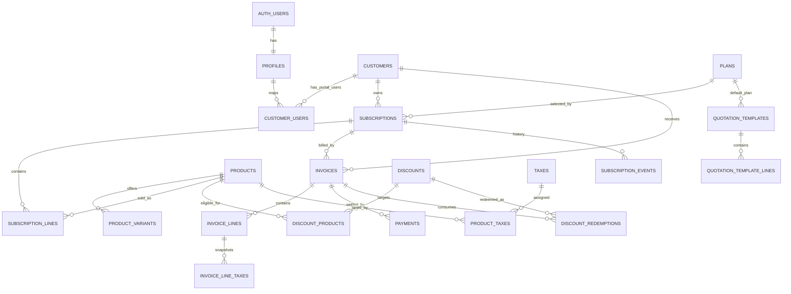

# 03 — Relational Database Design (Database Designer Handoff)

## 1. Design goals

1. Preserve a complete subscription and financial history.
2. Prevent duplicate billing even when a scheduler retries or overlaps.
3. Make the schema extensible for multiple product variants, plan frequencies, taxes, discounts, partial payments and multiple customer portal users.
4. Keep reads efficient for thousands of subscriptions/invoices.
5. Keep business rules in the server/domain layer and critical invariants in PostgreSQL constraints/transactions.

**Database:** PostgreSQL (managed by Supabase). UUID primary keys. `NUMERIC(14,2)` for monetary values; never `FLOAT` or `REAL`. Use `DATE` for billing dates and `TIMESTAMPTZ` for actual events.

## 2. Entity relationship map

`AUTH_USERS` is managed by Supabase Auth; it is not created by the application migration.

## 3. Tables and responsibility

| Table | Responsibility / important columns |
|---|---|
| `profiles` | Auth-linked identity and trusted `admin/staff/customer` role. |
| `customers` | Customer/business contact, billing address and currency. |
| `customer_users` | Many portal users can belong to a customer account; customer users are not allowed to see other customers. |
| `company_settings` | Single-company display/configuration defaults, currency and timezone. |
| `products` | Product catalogue, type, sales price, cost price, notes. |
| `product_variants` | Variant attribute/value and price delta (e.g. brand Odoo +560). |
| `taxes` / `product_taxes` / `plan_taxes` | Admin-configured percentage tax rules and assignment to catalogue items/plan base price. |
| `plans` | Recurrence unit/count, base price, minimum quantity, availability window and lifecycle flags. |
| `quotation_templates` / `quotation_template_lines` | Reusable quotation defaults and validity duration. |
| `subscriptions` | One lifecycle record for draft/quotation/confirmed/active/paused/closed; links customer, plan, dates and plan name/price snapshots. |
| `subscription_lines` | Product/variant/quantity/price snapshots copied from quotation. |
| `discounts` / `discount_products` | Rule definition, eligibility, date range, cap and product scope. |
| `invoices` | Invoice header, billing-period key, totals, payment balance and status. |
| `invoice_lines` / `invoice_line_taxes` | Immutable description/price/discount/tax snapshots. |
| `payments` | One payment record against one invoice; supports partial and multiple payments. |
| `discount_redemptions` | One record per discount use on a particular invoice; source of truth for usage cap. |
| `subscription_events` | State-transition history. |
| `billing_runs` | Scheduler/manual billing execution log and counts. |
| `audit_logs` | Sensitive administration and finance action history. |

## 4. Critical relationships and modelling decisions

### Product pricing and variants

`products.sales_price` is the normal price. `product_variants.price_delta` is an addition/subtraction for an attribute value. When a quotation is created, compute the final unit price once and save it on `subscription_lines.unit_price`. Example: base price 2,000 + Odoo variant delta 560 = 2,560. Existing subscriptions are not silently repriced when catalogue prices change.

### Plan and subscription line pricing

A plan has a recurring `price` and cadence. Model the plan base fee as one invoice line (`line_type = 'plan'`). Additional products/add-ons are represented by `subscription_lines` and copied into invoice lines (`line_type = 'product'`). This keeps plan price distinct from add-on sales price and supports quotations with plan + product lines.

### Billing period

Store `billing_interval_unit` and `billing_interval_count` on the plan, and `next_billing_date` on each subscription. Generated `billing_anchor_day` and `billing_anchor_month` columns preserve the original start-date anchor for monthly/yearly schedules. The billing period is `[period_start, period_end)` where `period_start` is the due date being processed and `period_end` is the next date obtained by adding the plan interval. Persist both on the invoice. Month-end addition must use calendar arithmetic (Jan 31 + one month → last valid day of February), not 30-day arithmetic.

### Historical invoice snapshots

Invoice lines keep `description_snapshot`, `quantity`, `unit_price`, `subtotal`, `discount_amount`, `tax_amount`, and tax name/rate snapshots. A product rename or tax-rate change must not rewrite an issued invoice. Future invoice generation may use the currently configured catalogue/tax values; document the effective date of rule changes in the audit log.

### Discounts

A discount row expresses type/value/scope/minimums/dates/max uses. `discount_products` holds eligible products only for product-scoped discounts. `discount_redemptions` records each actual use. To avoid race conditions, lock the discount row, count redemptions, apply only if under the cap, then insert the invoice and redemption in one transaction. Unique `(discount_id, invoice_id)` guarantees one use per discount per invoice.

### Payments

One `payments` row refers to one invoice. Multiple rows can settle an invoice over time. A database function/transaction locks the invoice, rejects payment amounts greater than `balance_due`, inserts payment, increments `amount_paid` and changes status to `paid` only when balance reaches zero. If later requirements need a single incoming payment allocated to multiple invoices, add a `payment_allocations` junction rather than overloading this model.

### Customer accounts

`customers` is a business/customer contact record. `profiles` is an authenticated human. `customer_users` maps one or more portal users to a customer record. This supports a large company with more than one portal login without allowing unrelated customer access.

## 5. Database constraints and indexes

The initial SQL migration includes core foreign keys, CHECK constraints and indexes. Do not remove them to make a form work.

Important indexes:

- `subscriptions(status, next_billing_date)` for billing batch selection.
- `subscriptions(customer_id, created_at DESC)` for customer portal/subscription lists.
- `subscriptions(plan_id, status)` for plan analysis.
- Partial unique index on `invoices(subscription_id, billing_period_start, billing_period_end)` where subscription id is not null.
- `invoices(status, due_date)` for overdue queue.
- `invoices(customer_id, issued_at DESC)` for customer and finance lists.
- `payments(invoice_id, paid_at)` for balance/revenue reads.
- `discount_redemptions(discount_id, redeemed_at)` for usage count.
- `subscription_events(subscription_id, created_at DESC)` for lifecycle timeline.
- Foreign-key columns used in joins/RLS predicates must be indexed.

## 6. Transaction boundaries — do not split these

### Generate a recurring invoice

One transaction per subscription billing period must: lock subscription, validate state/expiry, compute period, lock/check discount, insert invoice and lines/tax snapshots/redemption, advance next billing date, record event/log. If any step fails, none of that period should persist. Unique period index is the last duplicate guard.

### Record a payment

One transaction must: lock invoice, validate invoice state and balance, insert payment, update amount_paid and status, append audit record. It must not permit overpayment or payment against a cancelled/draft invoice.

### Confirm subscription

One transaction must validate quotation expiry and plan availability, change status, set confirmation/activation fields and record a subscription event.

## 7. Deletion and retention

- Prefer `is_active=false` for products/plans/taxes/discounts; do not physically delete a row referenced by financial history.
- Use `ON DELETE RESTRICT` for products, plans, customers, subscriptions and invoices after financial activity exists.
- Auth account deletion must not cascade-delete invoices/payments; customer account closure should deactivate portal access and preserve legal/financial records.
- Audit logs and invoice snapshots should be append-only to the extent practical.

## 8. Reporting query semantics

- `active_subscriptions`: count of subscriptions with status `active` as of now.
- `collected_revenue`: sum payments by `paid_at` within date filter.
- `outstanding_amount`: sum invoice `balance_due` where invoice status is `confirmed`.
- `overdue_invoices`: status `confirmed`, balance positive, due date `< current_date`.
- `invoiced_revenue`: sum confirmed/paid invoice totals in issued-date range (separate from cash collected).

Do not label invoiced totals as cash received. Add indexes and aggregate in SQL.

## 9. Migration policy

- Every schema change is a new migration; never edit an applied migration in a shared environment.
- Commit migrations and generated database types together.
- Use seed data only for demo records; keep production admin seeding separate and protected.
- Run database/RLS tests after every schema or policy change.
